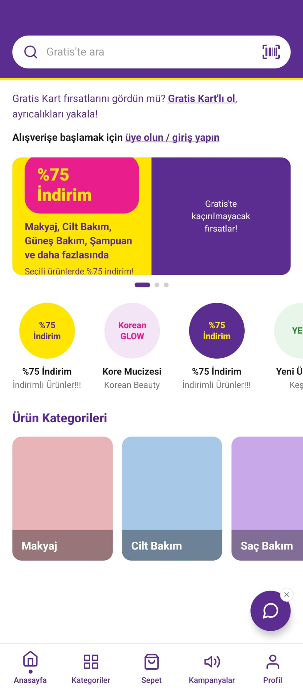
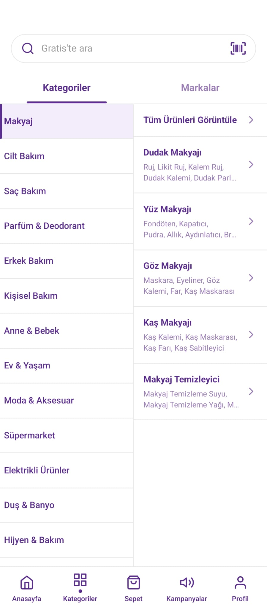
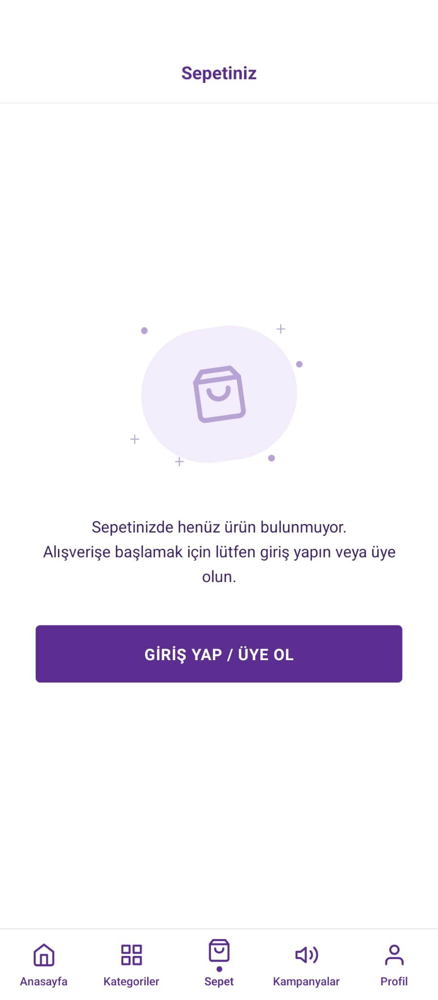
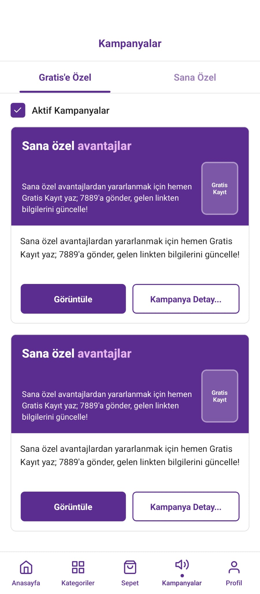
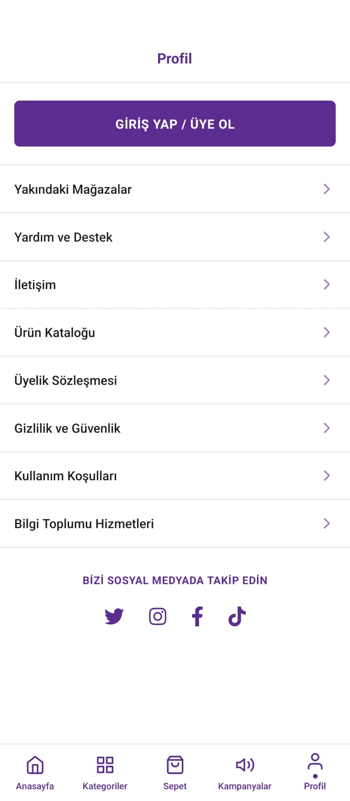

# Gratis Clone

## Ekran Görüntüleri

### Anasayfa


### Kategoriler


### Sepet


### Kampanyalar


### Profil


## Özellikler

- Splash ekranı ve otomatik yönlendirme
- Mor-sarı Gratis temalı arayüz
- Arama çubuğu ve barkod ikonu
- Kampanya banner carousel
- Hızlı erişim linkleri ve ürün kategorileri
- Kategori / marka sekmeli kategori ekranı
- Sol-sağ panel kategori navigasyonu
- Boş sepet durumu
- Kampanya kartları ve aktif kampanya filtresi
- Profil menüsü ve sosyal medya linkleri
- Alt tab bar navigasyonu (5 sekme)
- Portre modunda kilitli Android desteği

## Teknolojiler

| Paket | Sürüm |
| --- | --- |
| React Native | 0.82.1 |
| React | 19.1.1 |
| React Navigation | 6.x |
| react-native-screens | 4.26.2 |
| react-native-safe-area-context | 5.8.0 |
| react-native-vector-icons | 10.3.0 |
| react-native-gesture-handler | 3.1.0 |
| react-native-immersive-mode | 2.0.2 |

## Proje Yapısı

```
src/
├── assets/          # Uygulama içi görseller
├── common/          # NavigationService
├── components/      # Ekran bileşenleri
│   ├── common/      # ScreenHeader, SearchBar, TabBar, CtaButton
│   ├── home/
│   ├── splash/
│   ├── categories/
│   ├── cart/
│   ├── campaigns/
│   └── profile/
├── datas/           # Statik veriler ve renk paleti
├── hooks/           # useScreenDimensions
├── routes/          # Navigasyon yapılandırması
└── screens/         # Ekran giriş noktaları
```

## Kurulum

### Gereksinimler

- Node.js >= 20
- React Native geliştirme ortamı ([kurulum rehberi](https://reactnative.dev/docs/set-up-your-environment))
- Android Studio (Android) veya Xcode (iOS)

### Adımlar

```bash
# Bağımlılıkları yükle
npm install

# Metro bundler'ı başlat
npm start

# Android
npm run android

# iOS (ilk kurulumda pod install gerekir)
cd ios && bundle exec pod install && cd ..
npm run ios
```

## Navigasyon

```
Splash
  └── WelcomeNavigator (Bottom Tabs)
        ├── HomeNavigator → Anasayfa
        ├── CategoriesNavigator → Kategoriler
        ├── CartNavigator → Sepet
        ├── CampaignsNavigator → Kampanyalar
        └── ProfileNavigator → Profil
```

## Notlar

- Android uygulaması `AndroidManifest.xml` içinde **portre moduna** kilitlidir.
- `react-native-screens` için `patch-package` kullanılmaktadır (`postinstall` script).
- Uygulama açılışında immersive mode etkinleştirilir.